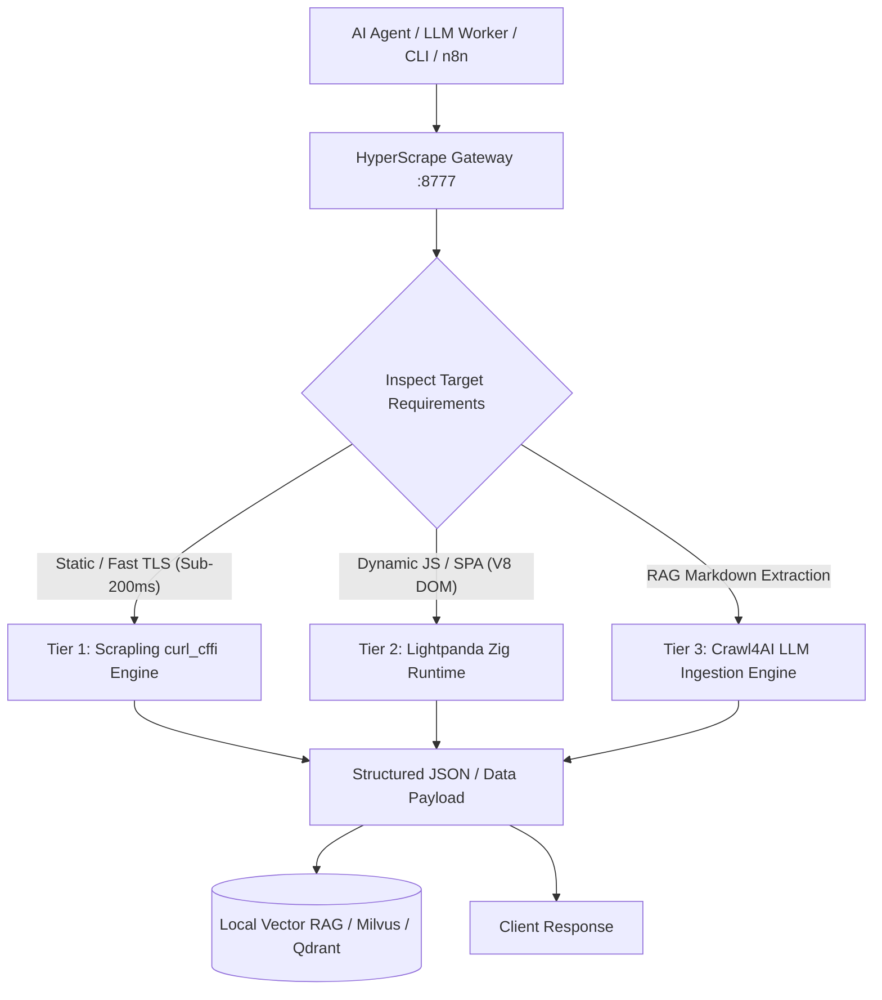

<div align="center">

# ⚡ HyperScrape

### Ultra High-Throughput 3-Tier Web Extraction & AI RAG Ingestion Engine
**Engineered for Autonomous AI Agents, LLM RAG pipelines, and Large-Scale Web Ingestion.**

[](LICENSE)
[](https://www.python.org/)
[](#architecture)
[](#tier-2-lightpanda-v8)
[](https://github.com/psf/black)

[Features](#key-features) • [Architecture](#system-architecture) • [Benchmarks](#performance-benchmarks) • [Quickstart](#quickstart) • [API Reference](#api-reference) • [Integrations](#integrations)

</div>

---

## 🌟 Overview

Modern AI web agents face a performance trilemma:
1. **Traditional Headless Browsers (Puppeteer/Playwright Chrome)**: Consume **1.5 GB – 2.5 GB RAM** per instance, with slow cold boots (2,000ms+) and high CPU rendering overhead (Skia graphics, layouts, and paint passes that LLMs do not need).
2. **Standard HTTP Crawlers (Requests/HTTPX)**: Instantaneous, but lack browser TLS fingerprinting and fail completely on JavaScript-rendered single-page applications (SPAs).
3. **RAG Extraction Complexity**: HTML soup requires heavy token-wasting cleanup before feeding to context windows.

**HyperScrape solves this by implementing an intelligent 3-Tier Pyramid Routing Architecture:**

```
                        ┌─────────────────────────────────────────────────────────┐
                        │ Tier 3: LLM RAG Synthesis & Markdown Ingestion          │
                        │ (Crawl4AI + BM25 Pruning + Structured Chunking)         │
                        ├─────────────────────────────────────────────────────────┤
                        │ Tier 2: Headless DOM & V8 JavaScript Execution          │
                        │ (Lightpanda Zig+V8 Core, 16x lower memory, no graphics) │
                        ├─────────────────────────────────────────────────────────┤
                        │ Tier 1: Sub-200ms Adaptive TLS Bypass Engine            │
                        │ (Scrapling + curl_cffi Impersonation + Fast CSS/XPath)  │
                        └─────────────────────────────────────────────────────────┘
```

---

## 🚀 Key Features

- **⚡ 3-Tier Intelligent Routing**: Automatically select or explicitly route requests to the fastest, lowest-overhead engine required.
- **🛡️ Advanced TLS & Browser Impersonation**: Built-in HTTP/2 and TLS fingerprint impersonation to bypass Cloudflare/Akamai bot-management without expensive proxy pools.
- **🧠 Native V8 Execution without GPU Overhead**: Lightpanda Zig runtime eliminates Skia, GPU rendering, and layout calculations, delivering 16× less memory usage than Headless Chrome.
- **📥 Auto-Ingest into Vector RAG**: One-flag indexing into vector databases or local BM25 RAG instances for instant retrieval.
- **🔌 Enterprise Orchestration Ready**: First-class support for **n8n workflows**, **FastAPI microservices**, **CLI tooling**, and **Tailscale Private Mesh networks**.
- **📦 Multi-Arch First**: Tested and optimized on **Linux aarch64 (Oracle Cloud / AWS Graviton / Apple Silicon)** and **x86_64**.

---

## 📊 Performance Benchmarks

Comparative benchmark run on **ARM64 Neoverse-N1 (2 vCPU, 11 GB RAM)** against a standard modern web endpoint:

| Metric | Headless Chrome (Playwright) | Lightpanda (Zig + V8) | Scrapling (curl_cffi) | HyperScrape Hybrid |
| :--- | :--- | :--- | :--- | :--- |
| **Peak Memory Footprint** | ~2,100 MB | **~71 MB** *(16x lower)* | **~35 MB** | **Dynamic 35–71 MB** |
| **Median Execution Latency** | ~2,250 ms | **~660 ms** *(3.4x faster)*| **~187 ms** *(12x faster)* | **Auto-optimized** |
| **Rendering Graphics Pipe** | Full GPU/Skia (Wasteful) | Stripped (Headless DOM) | None (Raw TLS) | Context-adaptive |
| **Anti-Bot Defense** | Requires stealth plugins | Native CDP / BiDi | Built-in TLS Spoof | Multi-layer |
| **LLM RAG Token Cleanliness** | Raw DOM (Messy) | Clean DOM | Extracted Nodes | **Clean BM25 Markdown** |

---

## 🏗️ System Architecture



---

## 📦 Quickstart

### 1. Installation

```bash
# Clone the repository
git clone https://github.com/Amz34/hyper-scrape.git
cd hyper-scrape

# Create virtual environment with uv or python venv
python3 -m venv .venv
source .venv/bin/activate

# Install dependencies
pip install -r requirements.txt
```

### 2. Download Native Lightpanda Binary (Optional for Tier 2)

```bash
# For Linux ARM64 (aarch64)
curl -L https://github.com/lightpanda-io/browser/releases/download/1.0.3/lightpanda-aarch64-linux -o bin/lightpanda
chmod +x bin/lightpanda

# For Linux x86_64
# curl -L https://github.com/lightpanda-io/browser/releases/download/1.0.3/lightpanda-x86_64-linux -o bin/lightpanda
# chmod +x bin/lightpanda
```

---

## 💻 CLI Usage

HyperScrape includes an ergonomic CLI for ad-hoc agent use:

```bash
# Scrape with automatic tier selection
python -m hyperscrape https://news.ycombinator.com

# Target dynamic SPAs using Lightpanda V8
python -m hyperscrape https://example.com --engine lightpanda --css "title::text"

# Auto-ingest directly into local Vector RAG
python -m hyperscrape https://en.wikipedia.org/wiki/Artificial_intelligence --rag
```

---

## 🌐 Production Microservice (FastAPI + Systemd)

Start the production-ready microservice daemon:

```bash
uvicorn hyperscrape.server:app --host 0.0.0.0 --port 8777 --workers 2
```

### Health Check:
```bash
curl -s http://localhost:8777/health
```
```json
{
  "status": "healthy",
  "engines": {
    "scrapling": "0.5.1",
    "lightpanda": "1.0.3",
    "crawl4ai": "enabled"
  }
}
```

### Extract Web Data:
```bash
curl -s -X POST http://localhost:8777/scrape \
  -H "Content-Type: application/json" \
  -d '{
    "url": "https://example.com",
    "engine": "auto",
    "css_selector": "title::text"
  }'
```

---

## 🔄 Integrations

### n8n Workflow Automation
HyperScrape includes a pre-built n8n template in [`examples/n8n_scraper_workflow.json`](examples/n8n_scraper_workflow.json):
1. Import workflow into n8n.
2. Direct webhook requests to `http://<YOUR_TAILSCALE_OR_LOCAL_IP>:8777/scrape`.
3. Feed structured responses directly into AI Agent chains or Slack/Discord alerts.

### Local Vector RAG Hook
HyperScrape bridges directly with vector databases:
```python
from hyperscrape import HyperScraper

scraper = HyperScraper()
result = scraper.scrape_and_ingest(
    url="https://docs.python.org/3/",
    rag_endpoint="http://127.0.0.1:8989"
)
print("Indexed Doc ID:", result["rag_doc_id"])
```

---

## 🛠️ Repository Structure

```
hyper-scrape/
├── .github/
│   └── workflows/
│       └── ci.yml               # Automated CI linting and test pipeline
├── bin/                         # Native binary execution location
├── examples/
│   ├── n8n_scraper_workflow.json # n8n workflow template
│   └── rag_pipeline_demo.py     # Live RAG demonstration
├── hyperscrape/
│   ├── __init__.py              # Core package exports
│   ├── cli.py                   # High-performance CLI entrypoint
│   ├── engines/
│   │   ├── tier1_scrapling.py   # Sub-200ms TLS impersonation engine
│   │   ├── tier2_lightpanda.py  # V8/Zig headless DOM execution
│   │   └── tier3_rag.py         # LLM RAG markdown extractor
│   ├── router.py                # Intelligent tier classification router
│   └── server.py                # Production FastAPI microservice
├── tests/
│   └── test_engines.py          # Unit & integration test suites
├── systemd/
│   └── hyperscrape.service      # Production systemd daemon unit
├── LICENSE                      # Apache 2.0 Open Source License
├── README.md                    # Enterprise architectural documentation
└── requirements.txt             # Clean pinned dependencies
```

---

## 🤝 Community & Contributing

Contributions, feedback, and enterprise benchmarks are welcome! 
- Submit issues or feature requests via GitHub Issues.
- Open a Pull Request following standard PEP-8 guidelines.

---

## 📜 License

Distributed under the **Apache License 2.0**. See [`LICENSE`](LICENSE) for more information.

<div align="center">
  <sub>Maintained by <b>Aamir Zahran (@Amz34)</b> • Built for the Open Source AI Community</sub>
</div>
